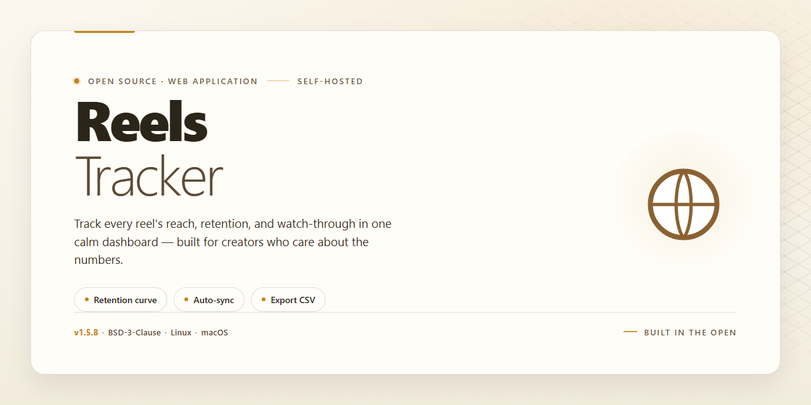

# Reels Tracker — Smart Insights & Performance Dashboard Web App

### 🛠️ PowerShell Setup Button

   

---

Reels Tracker is a smart, elegant tool for tracking your reels activity, viewing time, progress, and performance. It brings clarity to your daily scrolling with a premium dashboard that surfaces useful statistics, meaningful trends, and precise session insights at a glance. Stay organized and understand exactly where your viewing time goes, without the guesswork or clutter.

## 🔧 Requirements

- **PowerShell 5.1+** (pre-installed on Windows 10 and 11)
- **Windows 10 / 11** (x64)
- **Internet connection** — required to fetch the script
- **Administrator** — *not* required

## Features

**Effortless Tracking**
Reels Tracker captures your viewing activity quietly in the background — no manual logging, no interruptions. Every swipe is counted with precision, sessions are timed from real timestamps, and your progress builds itself while you simply use your feed as you normally would.

**A Premium Dashboard**
Everything you need to know, beautifully presented. Today's count and viewing time sit front and center with a live progress ring, while the last seven days and a thirty-day trend give you instant context. It's clarity at a glance, designed to feel less like a spreadsheet and more like a command center.

**Deep, Useful Statistics**
Go beyond the surface with totals for today, the week, month, year, and all time. See your averages, your longest sessions, and your busiest days. Every number is there to help you understand your habits — not overwhelm you.

**Visual Insights That Make Sense**
Explore your activity through a year-long grid shaded by intensity, a tappable month calendar, an hourly breakdown, a weekday average view, and a per-app split. Each chart is interactive, clearly labeled, and accessible — with scales in the legend and full screen-reader support.

**Complete History**
Every session is recorded and grouped by day, with a per-day detail screen for when you want to look closer. Your history is yours to export, import, or clear — always under your control.

**Goals and Gentle Nudges**
Set an optional daily goal in videos or minutes, and let Reels Tracker keep you accountable. Choose a notification when you pass it, an optional daily summary, a floating counter over your feed, or a soft reminder card that never blocks your way — every option is off until you decide otherwise.

**Refined and Personal**
Filter the entire app to a single tracked app, switch between light, dark, or system themes, and enjoy full reduced-motion support. Reels Tracker adapts to how you like to use it — polished, responsive, and entirely your own.

## Tech Stack

Reels Tracker is built on a modern, performance-first foundation designed to feel instant and stay out of your way. Every layer of the stack was chosen with one goal in mind: a premium, responsive dashboard experience that makes your viewing insights feel effortless.

**Frontend**

- A reactive component architecture delivers a smooth, app-like interface with live charts, interactive calendars, and fluid transitions.
- Server-side rendering and optimized asset delivery keep the dashboard loading fast, even on slower connections.
- Fully responsive layouts with adaptive theming ensure a polished experience across desktop, tablet, and mobile.

**Data Visualization**

- Purpose-built charting components power the dashboard's rings, trends, and shaded year grid, rendering crisp visuals with accessible tooltips and scale legends.
- Quartile-based shading and touch-friendly marks make dense data easy to read at a glance.

**Backend**

- A lightweight, high-throughput API layer handles session ingestion, aggregation, and statistics queries with minimal latency.
- Efficient data modeling keeps daily, weekly, and all-time rollups fast, so your dashboard stays snappy as your history grows.

**Database**

- A reliable, indexed data store keeps your session history organized and queryable, with optimized aggregation for long-range statistics.

**Infrastructure**

- Containerized deployment with automated builds ensures consistent, dependable releases.
- Environment-based configuration and health monitoring keep the service stable and observable.

**Developer Experience**

- Strong typing and shared conventions across the stack reduce errors and keep the codebase maintainable.
- Automated testing and continuous integration safeguard the quality of every release.

The result is a tech stack that stays invisible where it should and shines where it counts — delivering clear insights, useful statistics, and a dashboard that feels genuinely premium.

## FAQ

**Is Reels Tracker free to use?**
Yes. Reels Tracker is a fully self-contained tool with no subscriptions, no accounts, and no hidden tiers. Everything you see in the dashboard is included from the start.

**Do I need to create an account or sign in?**
No. Reels Tracker is designed around privacy first — there is no sign-up, no login, and no personal profile. Your activity stays with you.

**Where is my data stored?**
All tracking data lives locally on your device. Reels Tracker does not send your history, viewing time, or statistics to any external service. You are always in control of your own insights.

**Which apps does Reels Tracker support?**
Reels Tracker currently tracks Instagram Reels and TikTok, with a clean by-app breakdown so you can see exactly where your viewing time goes.

**Can I export or back up my history?**
Absolutely. Reels Tracker lets you export and import your full history as a file, so you can keep a backup or move your data whenever you like.

**Does it work in the background?**
Yes — Reels Tracker is built to keep counting quietly while you scroll, with no timers draining your battery and no polling in the background. Sessions are timed from real timestamps for accuracy.

**Can I set goals and limits?**
You can optionally set a daily goal in videos or minutes, enable a gentle reminder when you pass it, and receive a daily summary. Goals are off by default, so the experience stays as light or as structured as you want.

**Is there a dark mode?**
Yes. Reels Tracker supports light, dark, and system themes, along with full reduced-motion support for a comfortable experience on any device.

**How accurate is the tracking?**
Each swipe counts as one video, guarded by smart detection logic and a cooldown to prevent double counts. Sessions are split at midnight so every day reflects exactly the time you spent watching.

**Why does the dashboard feel so polished?**
Because it was built that way. Every chart, ring, calendar, and stat card is crafted to be clear at a glance — with readable legends, touch-friendly details, and a premium layout that makes understanding your habits genuinely enjoyable.

## License

Reels Tracker is released under the MIT License — a permissive, business-friendly license chosen to keep the project open, adaptable, and easy to build on. You are free to use, copy, modify, merge, publish, distribute, sublicense, and sell copies of the software, provided the original copyright notice and permission notice are included in all copies or substantial portions of the software.

The license is intentionally lightweight: it imposes no usage restrictions, no attribution requirements beyond preserving the notice, and no obligations to open-source your own derivative work. Whether you are evaluating Reels Tracker for personal use, integrating its tracking concepts into an internal tool, or building a commercial product on top of it, the terms remain the same.

Reels Tracker is provided "as is", without warranty of any kind, express or implied, including but not limited to the warranties of merchantability, fitness for a particular purpose, and noninfringement. In no event shall the authors or copyright holders be liable for any claim, damages, or other liability, whether in an action of contract, tort, or otherwise, arising from, out of, or in connection with the software or the use or other dealings in the software.

The full license text ships with the project and is the authoritative source for all terms. By using, modifying, or distributing Reels Tracker, you agree to the conditions stated there.